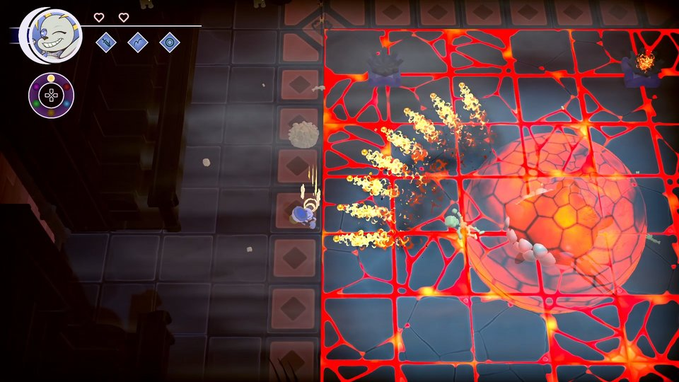
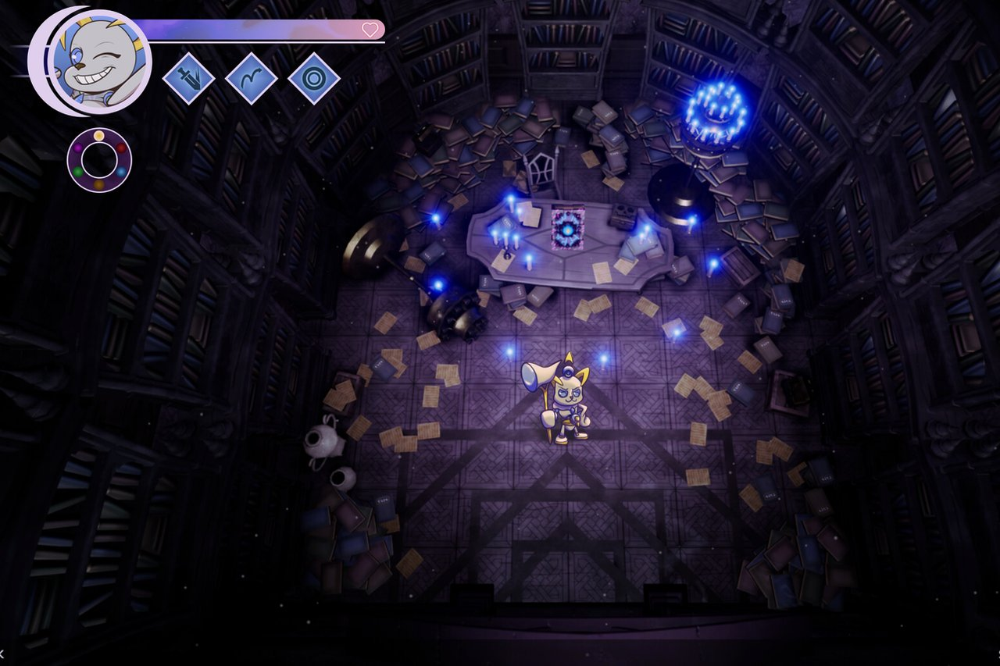
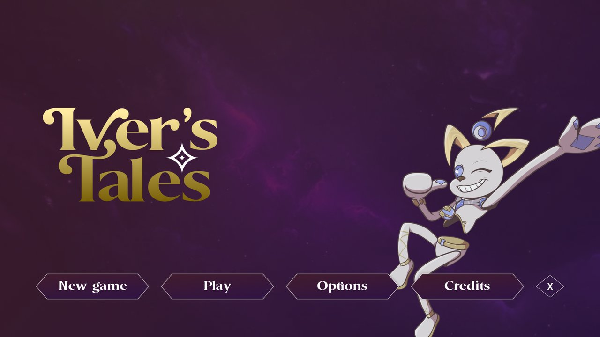
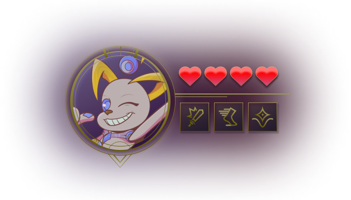

# Iver's Tales

[](https://github.com/miguelrg14/Ivers-Tales/actions/workflows/ci.yml)


**3D dungeon crawler made in Unity by a team of 7 students at UDIT (Madrid), 2023–2024.**
You play Iver, a small robot cat sent into the gothic kingdom of Diance to recover a
gem for her owner, using a hammer, a dash and three elemental spells to solve puzzles
and defeat enemies and bosses.

▶️ **Play the demo on itch.io:** <https://iguanago.itch.io/ivers-tales> ·
🎬 **Trailer:** <https://www.youtube.com/watch?v=PyGUNLEBmyA>

| | |
|---|---|
|  |  |
|  |  |

---

## My role

I was the team's **producer** and **lead of sound and UI**
(Miguel Rodríguez Gallego).

**Production**
- Set up and ran project management: Notion first, then a sprint/task spreadsheet with
  estimated vs. actual hours for every task and team member
  (17 sprints, ~1,600 logged hours – see the [production plan](docs/production/production-plan.md)).
- Organised weekly check-ins, alpha and beta milestones, presentations and the
  playtests with online feedback forms; published the beta on itch.io.
- Researched 61 publishers and contacted 10 of them with personalised cover letters
  ([publisher outreach](docs/production/publisher-outreach.md)).
- Business documents for the studio: [elevator pitch](docs/business/elevator-pitch.md),
  [business plan](docs/business/business-plan.md),
  [mission and values](docs/business/mission-vision-values.md),
  [Business Model Canvas](docs/business/business-model-canvas.png).
- The game was shown at **PS Talents** and **Match In Games 2024**.

**Programming (UI and audio)**
- Menus and in-game UI flow: main menu, pause menu, intro screens, options menu
  (graphics, controls and audio tabs) – [`Scripts/UI`](IversTales/Assets/_Project/Scripts/UI).
- Audio: sound-effect manager, audio mixers and volume settings –
  [`Scripts/Audio`](IversTales/Assets/_Project/Scripts/Audio).
- "See-through walls" camera system, together with Lucas –
  [`ObjectFader`](IversTales/Assets/_Project/Scripts/Camera/ObjectFader.cs).
- Placeholder music and sound effects used during development.

## Team

| Member | Role |
|---|---|
| Miguel Rodríguez | Producer, lead sound & UI |
| Iago López | Lead game design & programming (player, abilities, level design) |
| Lucas García | AI programming (enemies, bosses, behaviour trees) |
| Ariel Díaz | Lead artist (characters, animation), narrative |
| Alicia Díaz | Environment artist |
| Paloma Diosdado | 2D concept art & narrative (external support) |
| Celia Rodríguez | Marketing |
| Maya | UI art |
| NeoMedia Music | Music and sound effects (external) |

## Gameplay

| Action | Keyboard & mouse | Gamepad |
|---|---|---|
| Move | WASD / arrow keys | Left stick |
| Hammer attack | Right mouse button | B |
| Dash | Left mouse button | A |
| Select spell (light / fire / wind) | 1 / 2 / 3 | – |
| Cast spell | V | Y |
| Pause menu | Esc | Start |

- **Light** reveals hidden platforms and lights the torches in the level 2 boss fight.
- **Fire** shoots a fireball at distant enemies (unlocked during the game).
- **Wind** pushes heavy boxes.

The demo has a main menu, two levels with their bosses and a credits screen.

## Repository structure

| Path | Contents |
|---|---|
| [`IversTales/`](IversTales) | Unity 2022.3 project (URP) |
| [`IversTales/Assets/_Project/Scripts`](IversTales/Assets/_Project/Scripts) | Game code (C#), grouped by system: AI, Audio, Camera, Gameplay, Interactive, Player, UI, VFX |
| [`IversTales/Assets/_Project/Scripts/Core`](IversTales/Assets/_Project/Scripts/Core) | `IversTales.Core`: engine-independent game rules (no `UnityEngine` reference) |
| [`IversTales/Assets/_Project/Tests`](IversTales/Assets/_Project/Tests) | Unity Test Framework suites (edit mode and play mode) |
| [`IversTales/Assets/ThirdParty`](IversTales/Assets/ThirdParty) | Third-party packages (see [Licence](#licence)) |
| [`src/IversTales.Core`](src/IversTales.Core) | .NET project that compiles the Core sources outside Unity |
| [`tests/IversTales.Core.Tests`](tests/IversTales.Core.Tests) | xUnit tests for the Core library |
| [`docs/`](docs) | Production and business documentation |
| [`source-assets/`](source-assets) | Source files that are not imported by Unity (FL Studio project for a social media post) |

## Running the project

### Play
Download the Windows build from [itch.io](https://iguanago.itch.io/ivers-tales), or from
the [Releases](https://github.com/miguelrg14/Ivers-Tales/releases) page when available.

### Open in Unity
1. Clone the repository (about 0.5 GB; no Git LFS needed):
   ```bash
   git clone https://github.com/miguelrg14/Ivers-Tales.git
   ```
2. Open the `IversTales` folder with **Unity 2022.3.62f2** (any 2022.3 LTS ≥ 62f2 works).
3. Open `Assets/_Project/Scenes/MainMenu.unity` and press Play.

### Run the tests
Core logic (no Unity needed, .NET 8 SDK):
```bash
dotnet test IversTales.sln
```
Unity tests: *Window → General → Test Runner*, then run the **EditMode** and
**PlayMode** suites.

## Design notes

**Engine-independent core.** The rules that do not need the engine live in
`IversTales.Core`, an assembly definition with `noEngineReferences: true`. Unity compiles
it as part of the game, and the same files are linked by `src/IversTales.Core` so they
can be unit tested with plain .NET in CI. MonoBehaviours stay thin: they read input,
call the core and show the result.

| Core type | Used by | Responsibility |
|---|---|---|
| `PauseMenuStateMachine` | `UIManager` | HUD / pause / options / intro screens, time scale and cursor |
| `VolumeSettings`, `VolumeMath` | `AudioOptionsManager`, `AudioSettingsApplier` | Persisting volumes and converting slider values to decibels |
| `GraphicsSettingsLogic` | `GraphicOptionsManager` | Resolution list, quality mapping, brightness overlay, FOV scaling |
| `PlayerHealth` | `PlayerController` | Damage, hearts shown in the HUD and death event |
| `OcclusionTracker<T>` | `ObjectFader` | Which walls start/stop blocking the camera each frame |
| `SoundRegistry<TKey,TClip>` | `AudioManager` | Sound lookup with duplicate detection |
| `GameScenes` | menus, level exits | Scene names and level order |
| `Cooldown` | `PlayerSkills` | Fire spell cooldown |

**Options menu.** Each tab has its own manager. Controls are wired from code
(`onValueChanged.AddListener`) and values are saved in PlayerPrefs through an
`ISettingsStore` abstraction. Volume uses one AudioMixer per channel with an exposed
`*Volume` parameter; the master volume drives `AudioListener.volume`.
`AudioSettingsApplier` re-applies the saved values on every scene load.

**See-through walls.** The camera casts a ray to the player every frame; walls hit by
the ray switch their materials to a transparent blend and are restored to their exact
original state (colour, emission, blend mode, render queue) when they stop blocking the view.

**Enemy AI** (Lucas García) uses behaviour trees built with the AI Tree asset, NavMesh
agents with movement prediction for ranged enemies, and a hierarchical state machine
(UnityHFSM) for the level 2 boss.

## Tests

| Suite | Where | What it checks |
|---|---|---|
| Core unit tests (xUnit, 85 cases) | `tests/IversTales.Core.Tests` | Volume conversion and persistence, graphics settings, pause menu transitions, player health, occlusion tracking, sound registry, scene flow, cooldown |
| Edit mode (Unity) | `Assets/_Project/Tests/EditMode` | Build settings contain the four scenes; no missing scripts in scenes or prefabs; mixers expose the volume parameters |
| Play mode (Unity) | `Assets/_Project/Tests/PlayMode` | Every scene loads and runs for two seconds without errors; saved volume is applied when the menu loads |

Several tests are regression tests for bugs found in the original build (see below).

## Continuous integration

- **CI** (`.github/workflows/ci.yml`) – on every push: builds the solution and runs the
  core tests. If the Unity licence secrets are configured it also runs the Unity edit
  mode and play mode tests with [GameCI](https://game-ci.com) and builds the Windows
  player (artifact `IversTales-Windows`).
- **Release** (`.github/workflows/release.yml`) – pushing a tag such as `v1.0.0` builds
  the Windows player and publishes it as a GitHub release.

The Unity jobs need three repository secrets: `UNITY_LICENSE`, `UNITY_EMAIL` and
`UNITY_PASSWORD` (see the [GameCI activation guide](https://game-ci.com/docs/github/activation)).
The Unity `Library` folder is cached between runs.

## Changes since the original build

The project was cleaned up in 2026 for this portfolio:

- **Structure:** game content moved to `Assets/_Project`, third-party packages to
  `Assets/ThirdParty`; unused scenes, test content, package demos and unreferenced
  assets removed; everything renamed to English; uncompressed TGA textures
  converted to lossless PNG (1 GB → 0.2 GB), so the repository no longer needs Git LFS.
- **Code:** comments and identifiers translated to English, class names normalised,
  serialized data kept with `[FormerlySerializedAs]`.
- **Bugs fixed:**
  - Options menu: sliders and dropdowns had event listeners without a target, the
    mixers exposed no parameters and the graphics tab never initialised, so no option
    had any effect.
  - Volume was saved in decibels on the first launch and read back as a slider value.
  - Player hearts and death only triggered on exact health values (damage of 15 never
    killed the player); the player script also forced 60 FPS over the options.
  - The Credits button loaded a debug scene that was not in the build.
  - The see-through-walls system started a coroutine per wall per frame and restored
    walls to white instead of their original colour.
  - Gems, gem doors and kill zones reacted to any collider instead of only the player.
  - The audio manager crashed on duplicated sound keys.
- **Security:** project upgraded to Unity 2022.3.62f2, which fixes
  CVE-2025-59489 (builds made with older editors are affected).

## Licence

© 2023-2024 IguanaGo Studios. All rights reserved – see [LICENSE](LICENSE). This
is a student team project published as a portfolio.

Third-party assets keep their own licences: UnityHFSM (MIT), ExLib (Apache 2.0),
AI Tree and Apex (Renowned Games), Hyper Casual FX Pack Vol.1, Ultimate 10+ Shaders and
the Unity Particle Pack (Unity Asset Store EULA), and TextMesh Pro.
